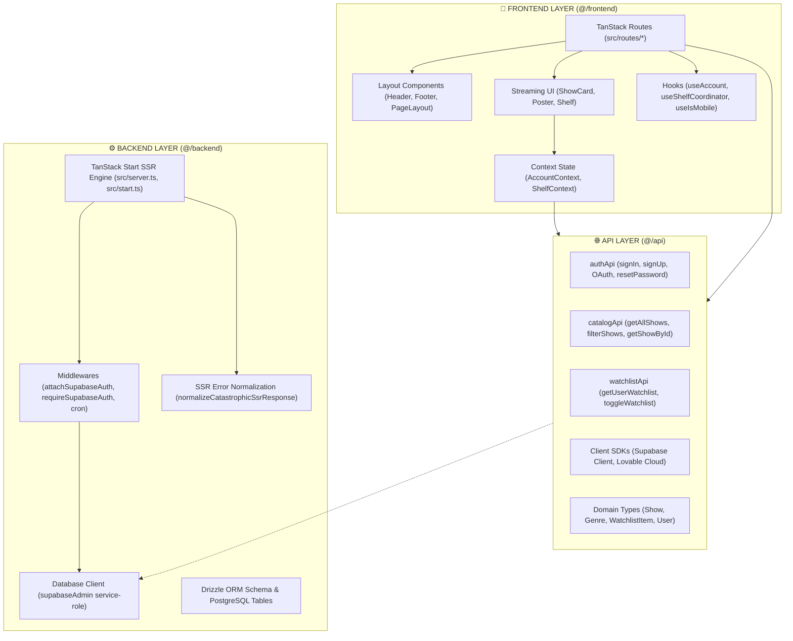

# Tadka4U Architecture Guide

Tadka4U is built with a **Clean 3-Tier Layered Architecture** separating the **Frontend Layer**, **Backend Layer**, and **API Layer**. This ensures clear boundaries, maintainability, simple onboarding, and strong security.

---

## 🏛️ High-Level Architectural Diagram



---

## 📂 Layer Breakdown & Identification

| Layer        | Directory       | Path Alias   | Primary Purpose                                                         | Key Exports                                                                                                                 |
| :----------- | :-------------- | :----------- | :---------------------------------------------------------------------- | :-------------------------------------------------------------------------------------------------------------------------- |
| **Frontend** | `src/frontend/` | `@/frontend` | Client presentation, UI components, React contexts, and custom hooks    | `PageLayout`, `Header`, `Footer`, `ShowCard`, `Shelf`, `AccountProvider`, `useAccount`, `pageHead`                          |
| **Backend**  | `src/backend/`  | `@/backend`  | Server runtimes, SSR handlers, database access, security middleware     | `supabaseAdmin`, `attachSupabaseAuth`, `requireSupabaseAuth`, `authenticateCronRequest`, `normalizeCatastrophicSsrResponse` |
| **API**      | `src/api/`      | `@/api`      | Centralized data services, CRUD operations, client SDK instances, types | `authApi`, `catalogApi`, `watchlistApi`, `supabase`, `lovable`, `shows`, `genres`, `Show`, `WatchlistItem`                  |

---

## 🎨 1. Frontend Layer (`src/frontend`)

Located at `src/frontend/` with barrel export `src/frontend/index.ts`.

### Subdirectories:

- `components/layout/`: Global layout components (`Brand`, `Header`, `Footer`, `AppBand`, `PageLayout`).
- `components/streaming/`: Streaming domain components (`ShowCard`, `Poster`, `Shelf`).
- `components/ui/`: Atomic UI primitives (Radix UI / shadcn: `Button`, `Carousel`, `Dialog`, etc.).
- `context/`: Application state providers (`AccountContext`, `ShelfContext`).
- `hooks/`: Reusable hooks (`useAccount`, `useShelfCoordinator`, `useIsMobile`).
- `utils/`: UI helpers (`pageHead` for route metadata).

### How to use:

```tsx
import { PageLayout, ShowCard, Shelf, useAccount, pageHead } from "@/frontend";

export function MyView() {
  const { user, saved, toggle } = useAccount();
  return (
    <PageLayout>
      <Shelf title="Featured Shows" />
    </PageLayout>
  );
}
```

---

## ⚙️ 2. Backend Layer (`src/backend`)

Located at `src/backend/` with barrel export `src/backend/index.ts`.

### Subdirectories:

- `db/`: Database access and ORM schemas.
  - `client.server.ts`: Privileged `supabaseAdmin` client (service-role key). Server-only.
  - `schema.ts`: Drizzle ORM schema models and Supabase types.
- `middleware/`: Request lifecycle and security middlewares.
  - `attachSupabaseAuth`: Attaches user session to TanStack Start server functions.
  - `requireSupabaseAuth`: Protects server functions with Bearer token validation.
  - `authenticateCronRequest`: Authenticates scheduled cron tasks.
- `server-error.ts`: Error handling normalizer for catastrophic SSR exceptions.

### How to use:

```ts
import {
  supabaseAdmin,
  attachSupabaseAuth,
  requireSupabaseAuth,
  normalizeCatastrophicSsrResponse,
} from "@/backend";
```

---

## 🌐 3. API Layer (`src/api`)

Located at `src/api/` with barrel export `src/api/index.ts`.

### Files:

- `auth.ts`: Methods for sign-in, sign-up, Google OAuth, session retrieval, password reset.
- `catalog.ts`: Methods for querying shows, genres, search/filters, and featured spotlights.
- `watchlist.ts`: CRUD operations for saving shows to user watchlist in PostgreSQL.
- `client.ts`: Supabase client and Lovable Cloud integration client.
- `types.ts`: Domain models (`Show`, `Genre`, `WatchlistItem`, `User`, `Session`, `Database`).

### How to use:

```ts
import { catalogApi, authApi, watchlistApi, type Show } from "@/api";

// Query catalog
const romanceShows: Show[] = catalogApi.filterShows("Romance");

// Query watchlist
const { showIds } = await watchlistApi.getUserWatchlist(userId);

// Authenticate user
const { error } = await authApi.signInWithEmail(email, password);
```

---

## 🚦 Routing (`src/routes`)

TanStack Start uses file-based routing in `src/routes/`:

- `__root.tsx`: Root shell wrapping every route with `QueryClientProvider` and `AccountProvider`.
- `index.tsx`: Home page (`/`).
- `explore.tsx`: Browse & search shows (`/explore`).
- `show.$showId.tsx`: Dynamic detail page (`/show/:showId`).
- `my-list.tsx`: Watchlist page (`/my-list`).
- `originals.tsx`: Curated originals (`/originals`).
- `auth.tsx` & `reset-password.tsx`: Authentication flows.
- `about.tsx`, `contact.tsx`, `privacy.tsx`, `terms.tsx`: Informational pages.

---

## 🛠️ Adding a New Feature

When adding a new feature (e.g. "User Watch History"):

1. **Backend Layer (`src/backend`)**:
   - Define database schema in `src/backend/db/schema.ts`.
   - Add any privileged server queries or middleware in `src/backend/`.
2. **API Layer (`src/api`)**:
   - Create `src/api/history.ts` exposing `historyApi` (`getHistory`, `addToHistory`).
   - Define types in `src/api/types.ts`.
   - Export from `src/api/index.ts`.
3. **Frontend Layer (`src/frontend`)**:
   - Create presentation components in `src/frontend/components/`.
   - Add state management hook in `src/frontend/hooks/`.
   - Export from `src/frontend/index.ts`.
4. **Route (`src/routes`)**:
   - Add file route `src/routes/history.tsx` consuming `@/frontend` and `@/api`.
